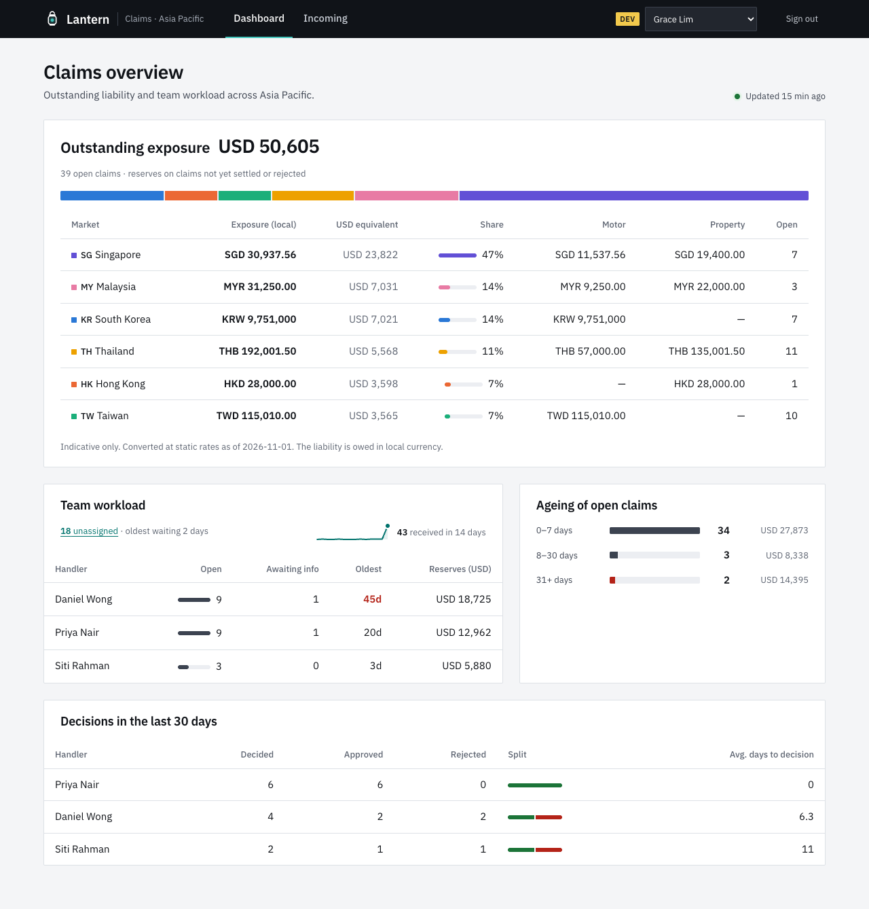
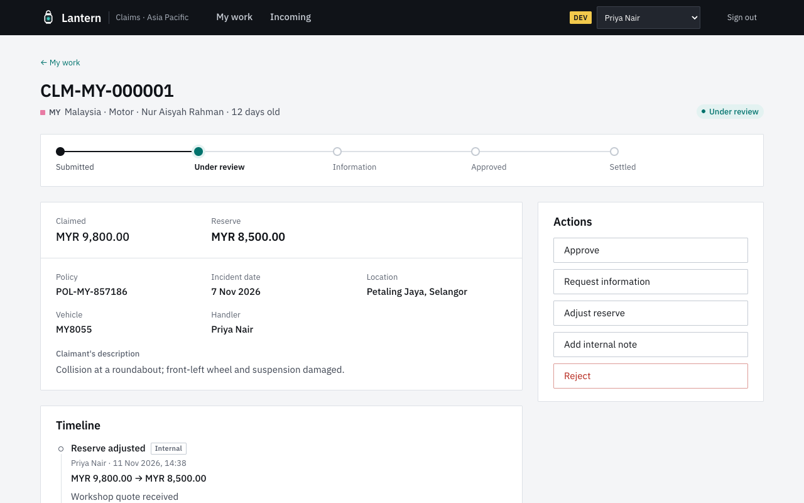
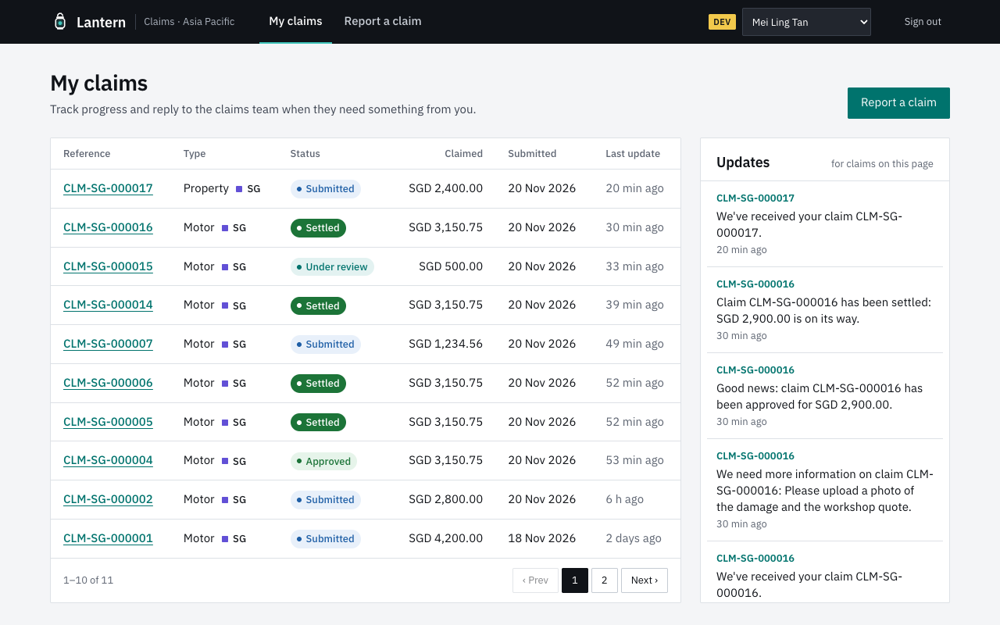

# Lantern

**Every claim visible, from report to payout.**

Lantern is a claims platform for motor and property insurance across six Asia Pacific markets: South Korea, Hong Kong, Taiwan, Thailand, Malaysia and Singapore. Claimants report and track their claims, handlers work them through to a decision, and managers see how much is owed in every market.

Built with **.NET 10, PostgreSQL, Kafka and Angular 21**.



## What each person can do

| Role | In Lantern they can… |
|---|---|
| **Claimant** | Report an incident, see exactly where their claim is, answer the claims team's questions, and see the decision and payment |
| **Claims handler** | Pick up new claims, ask the claimant for information, set the expected cost (the *reserve*), approve or reject, and settle |
| **Manager** | See the money still owed in each market's own currency with a USD total, who is working on what, how old claims are, and recent decisions |

| Handler working a claim | Claimant's view |
|---|---|
|  |  |

## Run it locally

**You need:** .NET 10 SDK, Node 22+, and PostgreSQL 17 plus Kafka (Docker, or Homebrew on macOS).

**1. Start Postgres and Kafka**

```bash
docker compose up -d postgres kafka
```

No Docker? See [running Postgres and Kafka with Homebrew](#appendix-postgres-and-kafka-with-homebrew) below.

**2. Start the two services and the app, each in its own terminal**

```bash
cd backend/src/Claims.Api   && dotnet run     # Claims API    → http://localhost:5001
cd backend/src/Insights.Api && dotnet run     # Insights API  → http://localhost:5002
cd frontend && npm install && npm start      # the app       → http://localhost:4200
```

The databases are created and filled with demo data on first start.

**3. Open http://localhost:4200** and pick who to sign in as.

> **Docker in one command:** `docker compose up --build` starts everything, including the app behind nginx. It's written and config-checked, but **I haven't been able to run it**, because Docker broke on my machine mid-sprint ([journal 4.5](docs/AI_JOURNAL.md#45-environment-issue-disk-full-docker-storage-corrupted)). The steps above, using Homebrew for Postgres and Kafka, are the ones I've verified end to end.

## Take the two-minute tour

There's no real sign-in. Choose a person on the sign-in page, and switch any time with the **DEV** menu in the header.

1. **Mei Ling Tan** (claimant) → **Report a claim**. She gets a reference like `CLM-SG-000018` straight away.
2. **Priya Nair** (handler) → **Incoming** → **Pick up** → **Request information**.
3. **Mei Ling Tan** sees the question at the top of **My claims** → opens the claim → **Send reply**.
4. **Priya Nair** → **Adjust reserve** → **Approve** → **Settle and close**.
5. **Grace Lim** (manager): the dashboard reflects the change within about five seconds. "Updated … ago" in the corner shows how fresh the numbers are.

Prefer the API? Use Swagger at http://localhost:5001/swagger (choose *Authorize* and enter a user id such as `handler-1`) and http://localhost:5002/swagger (`manager-1` with role `Manager`).

<details>
<summary>All demo users</summary>

| Role | User ids |
|---|---|
| Claimant | `claimant-sg` (Mei Ling Tan), `claimant-kr`, `claimant-hk`, `claimant-tw`, `claimant-th`, `claimant-my` |
| Handler | `handler-1` (Priya Nair), `handler-2` (Daniel Wong), `handler-3` (Siti Rahman) |
| Manager | `manager-1` (Grace Lim) |
</details>

## How it works

Lantern is two backend services, each with its own database, connected by Kafka:

```
                 ┌──────────────┐  same transaction   ┌──────────────────┐
  Angular ─REST─▶│  Claims API  │────────────────────▶│ claims DB+outbox │
     │           └──────────────┘                     └────────┬─────────┘
     │                                                         │ publisher
     │           ┌──────────────┐                     ┌────────▼─────────┐
     └─────REST─▶│ Insights API │◀────── consumes ────│  Kafka topic     │
                 └──────────────┘                     │  claims.events   │
                                                      └──────────────────┘
```

- **Claims** handles every change to a claim. It has to be exactly right and answer immediately, so the app talks to it over REST.
- **Insights** powers the dashboard and claimant notifications. It adds up figures across every claim and can be a few seconds behind, so it builds its own copy of the data from the events Claims publishes to Kafka.

Claims never waits on Insights. If Insights is down, people can still submit and process claims, and the dashboard catches up when it comes back.

### Key design decisions

| The problem | What Lantern does | Where to look |
|---|---|---|
| Two handlers click **Pick up** on the same claim at the same moment | Exactly one gets the claim. The other is told someone got there first (HTTP 409), and nothing is overwritten. | [`ClaimRepository.cs`](backend/src/Claims.Api/Data/ClaimRepository.cs) |
| Kafka is down when a claimant submits | The claim is still accepted. Its event is saved in the same database transaction (a "transactional outbox") and sent to Kafka once it's back. | [`OutboxPublisher.cs`](backend/src/Claims.Api/Outbox/OutboxPublisher.cs) |
| Kafka delivers the same event twice, or out of order | The dashboard never double-counts. Insights remembers which events it has applied and ignores anything older than what it already has. | [`ClaimEventHandler.cs`](backend/src/Insights.Api/Projection/ClaimEventHandler.cs) |
| Status rules duplicated in frontend and backend drift apart | The rules live in one table in the backend. The API tells the app which buttons to show, so the frontend never re-implements them. | [`ClaimStateMachine.cs`](backend/src/Claims.Api/Domain/ClaimStateMachine.cs) |
| Six currencies, and the Korean won has no cents | Amounts are stored as exact decimals in the claim's own currency, and checked against that currency's decimal places. USD appears only on the dashboard, at fixed rates labelled as indicative. | [`Money.cs`](backend/src/Claims.Api/Domain/Money.cs), [`DashboardCalculator.cs`](backend/src/Insights.Api/Dashboard/DashboardCalculator.cs) |
| A dashboard query slowing down claim processing | Reporting runs in its own service with its own database, so heavy reads never touch the database that takes the writes. | [`Insights.Api`](backend/src/Insights.Api) |

The full reasoning, including what uses REST vs Kafka and why, is in [docs/ARCHITECTURE.md](docs/ARCHITECTURE.md).

## Tests

```bash
cd backend && dotnet test                    # 115 tests
cd frontend && npx ng test --watch=false     # 8 tests
```

- **Domain rules:** every allowed and forbidden status change, money precision and reserve rules. Property-based tests (FsCheck) also run thousands of random action sequences. They found a real bug: a claimant could pick up their own claim ([journal 3.4](docs/AI_JOURNAL.md#34-property-test-found-a-real-bug)).
- **API against a real Postgres** (Testcontainers): the full claim lifecycle, the pick-up race, and claimants never seeing each other's claims or internal figures. These tests need Docker, so they haven't been re-run since it broke; everything else runs without it.
- **Dashboard maths:** duplicated or reordered events always give the same totals, and the USD headline always equals the sum of the market rows.

## Limitations

The brief puts the backend first, so most of the depth is there. The frontend covers every role's main flow.

- **No real sign-in.** You pick a demo user, and each request says who you are in a header. Both services enforce roles. Production would use a proper identity provider (JWT), with the same endpoints and rules.
- **The app checks for updates** every 5–30 seconds rather than receiving them pushed from the server.
- **FX rates are fixed**, seeded for demo purposes. A market without a rate still shows its local amount, flagged "No rate".
- **Not built:** document upload, policy and coverage checks, payments, email and SMS, reassigning claims. Each has a production approach in [ACCEPTANCE_CRITERIA.md §8](docs/ACCEPTANCE_CRITERIA.md#8-explicitly-out-of-scope).

## Documentation

| Document | Read it for |
|---|---|
| [ARCHITECTURE.md](docs/ARCHITECTURE.md) | Service boundaries, REST vs Kafka, reliability and the data model |
| [ACCEPTANCE_CRITERIA.md](docs/ACCEPTANCE_CRITERIA.md) | The definition of done. Commits and tests reference its IDs |
| [AI_JOURNAL.md](docs/AI_JOURNAL.md) | How I worked with AI: what I asked for, accepted, challenged and overrode |
| [DESIGN.md](docs/DESIGN.md) | The frontend's design direction |

```
backend/src/Claims.Api        claim lifecycle API and domain rules
backend/src/Insights.Api      Kafka consumer and dashboard API
backend/src/Claims.Contracts  the event format (the only code the two services share)
backend/tests/                unit, property-based and integration tests
frontend/                     the Angular app
docs/                         the documents above
```

## Appendix: Postgres and Kafka with Homebrew

The services expect Postgres on port **5433** (user and password `claims`, with databases `claims` and `insights`) and Kafka on **127.0.0.1:9092**.

```bash
brew install postgresql@17 kafka
mkdir -p .local
PG=/opt/homebrew/opt/postgresql@17/bin   # postgresql@17 isn't on PATH by default

# Postgres
echo claims > .local/pw
$PG/initdb -D .local/pg -U claims --pwfile=.local/pw -A scram-sha-256
$PG/pg_ctl -D .local/pg -o "-p 5433" -l .local/pg.log start
PGPASSWORD=claims $PG/psql -h localhost -p 5433 -U claims -d postgres \
  -c "CREATE DATABASE claims;" -c "CREATE DATABASE insights;"

# Kafka (single node)
cat > .local/kafka.properties <<'EOF'
process.roles=broker,controller
node.id=1
controller.quorum.voters=1@localhost:9093
listeners=PLAINTEXT://localhost:9092,CONTROLLER://localhost:9093
advertised.listeners=PLAINTEXT://localhost:9092
controller.listener.names=CONTROLLER
listener.security.protocol.map=PLAINTEXT:PLAINTEXT,CONTROLLER:PLAINTEXT
log.dirs=.local/kafka-logs
offsets.topic.replication.factor=1
transaction.state.log.replication.factor=1
transaction.state.log.min.isr=1
auto.create.topics.enable=false
EOF
kafka-storage format -t "$(kafka-storage random-uuid)" -c .local/kafka.properties
kafka-server-start .local/kafka.properties    # leave this running
```

---

Built as an assessment submission. No license is granted for reuse.
