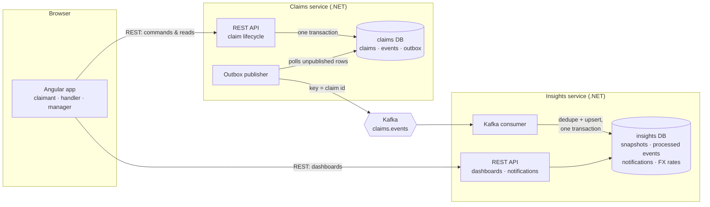
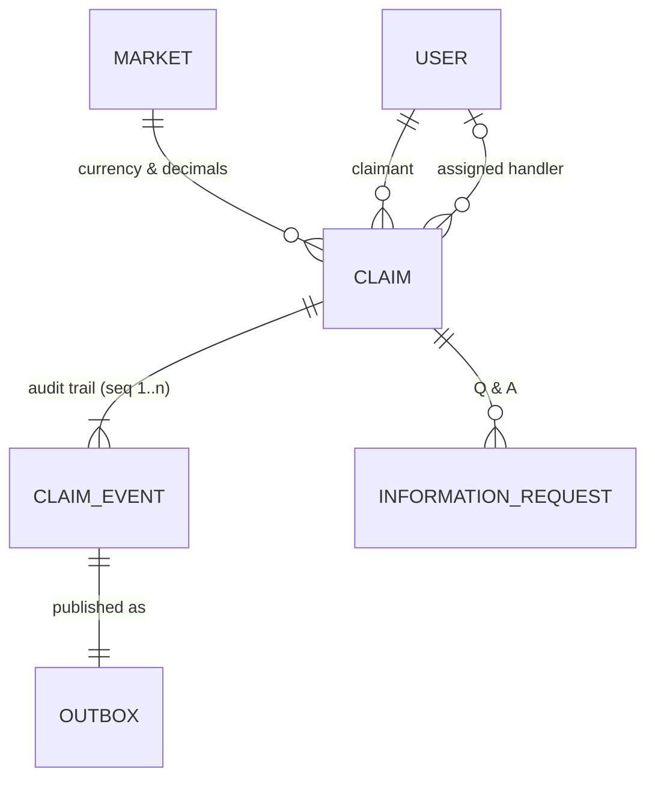

# Architecture

## The shape of it

There are two services, each with **its own database**. **Claims never calls Insights, and Insights never reads the Claims database.** The only thing they share is the event contract (`Claims.Contracts`).

## Why two services, and why not more

The system does two jobs with opposite needs:

| | Claims | Insights |
|---|---|---|
| Must be | **Exactly right, immediately.** One handler per claim, no paying twice, no illegal transitions. | **Fast to read, can lag a few seconds.** Aggregates across every claim. |
| Talks via | REST: the user is waiting for a yes or no | Kafka in, REST out |
| If it's down | Nothing works, so it stays small and simple | Claims carries on; Insights catches up from Kafka |

Splitting along that line:
- gives Kafka a real job
- isolates failures: dashboards can't slow down or break claim processing
- leaves both sides free to scale independently

Splitting further (separate assessment, notification and policy services) would add deployment and failure points without a matching benefit at this size. Inside the Claims service, the domain, persistence and HTTP layers are kept apart, so it can be split later along known lines.

**In one line:** *Kafka decouples consistent claims processing from lag-tolerant reporting.*

## What uses REST and what uses Kafka

| Interaction | Transport | Why |
|---|---|---|
| Submit, pick up, request info, respond, reserve, approve, reject, settle | REST (sync) | The user needs an authoritative answer now, e.g. "you got it" or "409, someone else did" |
| My claims, the queue, claim detail | REST against Claims | Must be strongly consistent: never show a taken claim as free |
| Exposure, workload, ageing, performance | REST against Insights, **built from Kafka** | Aggregates can lag; building them must never slow down writes |
| Claimant notifications | Kafka → Insights | A side effect that doesn't need to block the request |

## How events stay reliable

1. **Transactional outbox (Claims).** Every claim change writes its audit `ClaimEvent` and an `Outbox` row **in the same database transaction**. A background publisher sends unpublished rows to Kafka in insert order (`acks=all`, idempotent producer) and marks them published only after Kafka acknowledges them.
   - If Kafka is down, the API keeps working and rows build up in the outbox.
   - Verified by hand: Kafka was stopped, a claim was submitted (201), and the event was delivered once Kafka restarted.
2. **Ordering.** The message key is the claim id, so all of one claim's events land on the same partition, in order.
3. **Event-carried state.** Each message carries the claim's full snapshot after the event, plus a per-claim `Sequence`. Insights never needs to call back into Claims.
4. **Idempotent consumer (Insights).** For each message, in one transaction: skip it if `EventId` has already been processed; otherwise record it, upsert the snapshot **only if `Sequence` is newer**, and add a notification. The Kafka offset is committed only after that transaction commits.
   - Together this turns at-least-once delivery into effectively-once processing. It is property-tested with random duplicates and reordering.
5. **Fault isolation.** Stop Insights and Claims is unaffected. On restart, Insights resumes from its last committed offset. Verified by hand: it processed exactly the one event it had missed.

## Domain model (Claims)

- **Claim** is the aggregate. Every state change is a method on it, and each emits exactly one event. The rules are unit-tested and property-tested without a database.
- **State machine:** a single lookup table of legal `(status, action)` pairs. Anything else is a 409.
- **Reserve** is the insurer's estimate of what it will pay:
  - starts at the claimed amount
  - the handler can adjust it
  - set to the approved amount on approval
  - released to 0 on settlement or rejection
  - **Outstanding exposure = sum of reserves on open claims.**
- **Money:** `decimal` / `numeric(19,4)`, always in the claim's own currency, validated against ISO 4217 minor units (KRW has 0).
- **Markets are data**, not an enum. Adding one is a seed row.
- **Concurrency:** Postgres `xmin` as the optimistic concurrency token. When two handlers pick up the same claim, exactly one wins and the other gets a 409 (covered by an integration test).

## Multi-currency exposure

- Each market's figure is **in its own currency**, because that is what's actually owed.
- **USD is the headline total**, because that is how the group reports.
- USD is calculated when the dashboard is read, from **static seeded FX rates** with an "as of" date, and is never stored. It is labelled *indicative*.
- In production this would use a daily rates feed, with period-end rates for financial reporting.

## Contract ownership

- The **backend owns the contract.** Both services publish OpenAPI (Swagger UI at `/swagger`), and the Angular types in `frontend/src/app/core/models.ts` follow it.
- The staff UI renders the `availableActions` the API returns, not its own copy of the state machine.
- The event contract is versioned additively. A breaking change would need a new topic or a schema version.

## Identity (development only)

- Requests carry `X-User-Id`, which a real ASP.NET authentication handler resolves to a seeded user and role. Route groups are protected by role policies.
- The domain also enforces its own rules: for example, only a Handler can pick up a claim, whatever entry point is used.
- Production would replace the dev header with OIDC/JWT and leave everything else the same.

## Production next steps

These were deliberately not built:

- **Real authentication:** OIDC for staff, customer identity for claimants. Insights would enforce the Manager role.
- **Outbox scale-out:** partition the publisher by key. Plain `SKIP LOCKED` would break per-claim ordering.
- **Dead-letter topic** for messages that can't be deserialised; today they are logged and skipped.
- **Push updates** to the UI (SSE or WebSocket fed from the Kafka stream) instead of polling.
- **Pre-aggregated read models** once snapshot aggregation per request gets slow.
- **Data residency** per market, which matters across six jurisdictions.
- **Documents and photos**, a **policy/coverage service**, **payments** integration, **fraud scoring**.
